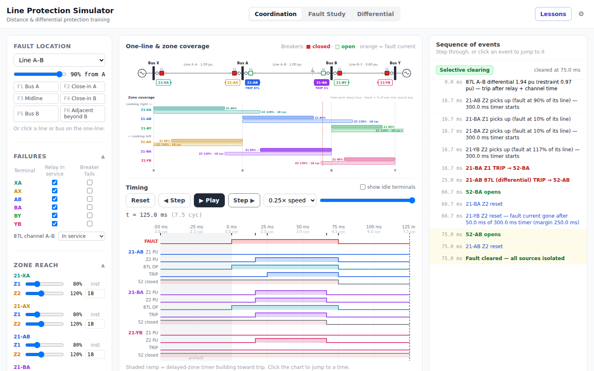
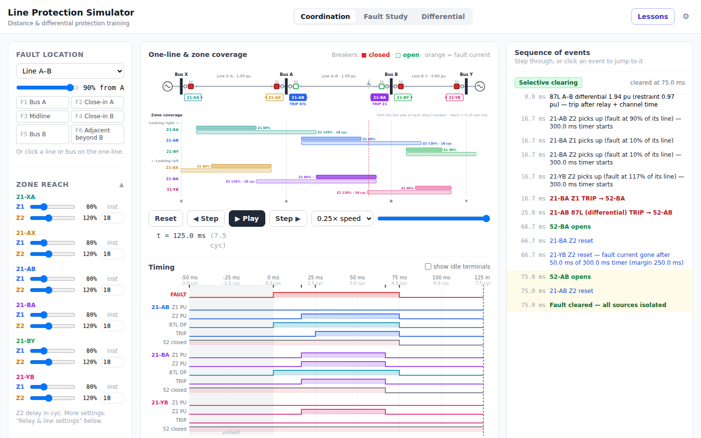

# Line Protection Simulator

An interactive, browser-based training simulator for transmission line protection: distance zones and coordination, pilot schemes, and line current differential. Place a fault, step through the clearing sequence event by event, and see why each relay did (or didn't) trip.

**Try it:** https://powerjc.github.io/line-protection-sim/



## What it covers

- **Distance protection:** MHO and quadrilateral zones, Zone 1 / Zone 2 reach and timing, remote backup, coordination time interval, relay out of service, stuck breakers
- **Clearing in time:** a discrete-event engine (relay operate time, zone timers, breaker interrupt time, network re-solved after every opening) shown as a one-line with fault-current paths, a logic-analyzer timing chart and a sequence-of-events log with an outcome verdict
- **Pilot schemes:** DCB, POTT and DCUB with channel failures (out of service, lost at fault)
- **System realism:** a three-phase phasor network solver: source impedance (SIR), phase-to-ground faults with zero-sequence networks and k0 compensation, fault resistance, infeed, prefault load flow, memory polarization
- **Line current differential (87L):** percentage differential characteristic, line charging current, CT error, and 87L in the clearing sequence alongside distance
- **Why it matters:** an optional consequences card (clearing time against a critical clearing time, relative fault duty and arc energy, outage extent) and failures across the protection chain (relay, breaker, station DC supply, teleprotection channel)
- **Learner levels and audiences:** Basic / Intermediate / Advanced feature groups, and a welcome path for people who work around protection (networks, SCADA, commissioning)
- **Tapped lines:** an unprotected load tap on the line: tap-section faults fed from both ends (infeed underreach), faults behind the tap transformer, and the tap load as unmeasured 87L current
- **31 guided lessons** in eight tracks, from "What a fault costs" and "Zone 1: instantaneous, but short" to "Load + Rf: the sending end overreaches"

Everything advanced is behind ⚙ Settings (learner level, individual features, modules) and off by default, so a first-time user sees a simple two-relay line.



## Run it

Requires Node.js 18+.

```bash
cd app
npm install
npm run dev      # http://localhost:5173
npm test         # simulation and lesson tests (Vitest)
npm run build    # static site in app/dist
```

All simulation runs in the browser; there is no backend. The simulation code (`app/src/lib/`) is plain JavaScript with no React dependency (except `units.js`, a display-units context).

## Deploy

The production build is a static site. **GitHub Pages:** `.github/workflows/pages.yml` builds and publishes it on every push to `main` (the repo needs Settings → Pages → Source: "GitHub Actions"); it sets `VITE_BASE=/line-protection-sim/` because Pages serves the project under that path. **Docker:** `docker compose up -d --build` serves it from an unprivileged nginx container on `127.0.0.1:8080`, meant to sit behind a reverse proxy that handles TLS (example vhost in `app/deploy/nginx-host.conf.example`). See `SPEC.md` § Deployment.

## Model notes and limits

- Impedances are per-unit of the base line A–B; all lines and sources share the line angle unless a Z0 angle is set; the network is a chain (X–A–B–Y), with an optional tap on line A–B
- The tap is an unprotected *load* tap only (no source tap, no three-terminal line yet); its transformer protection is a fixed clearing time
- Steady-state phasors only: no transients, CVT or CT saturation dynamics (CT error is a fixed magnitude error), no load-encroachment trips
- Relays are idealized: a simple phase selector, exact measurement, fixed operate time
- Consequences are relative and illustrative: fault duty and arc energy are multiples of a fast clear, and the critical clearing time (default 12 cycles) is a teaching value; real ones come from stability studies of the actual system
- It's a teaching tool, not a setting-calculation tool. Don't use it to set real relays.

Design notes, the model and the backlog are in [`SPEC.md`](SPEC.md). A companion IEC 61850 (GOOSE / Sampled Values) simulator is planned as a separate project; [`docs/iec61850-interface.md`](docs/iec61850-interface.md) describes where the line between the two sits.

## License

[MIT](LICENSE)
